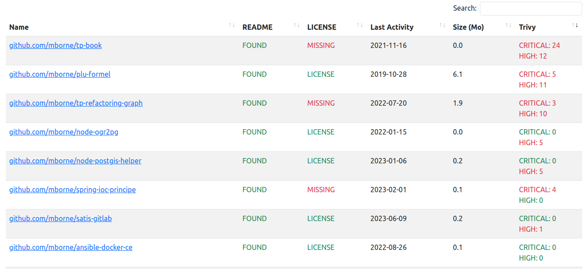

# git-manager

[](https://github.com/mborne/git-manager/actions/workflows/ci.yml)

CLI helpers to backup and review a set of git repositories.

## Features

* Retrieve and backup hosted GIT repositories (github, gitlab, gogs, gitea)
* Compute stats and performs some basic checks (ex : README.md, LICENSE, [trivy scan](https://aquasecurity.github.io/trivy/),...)
* View stats and checks :



* Expose the results through an HTTP API described by [docs/openapi.yaml](docs/openapi.yaml)

## Requirements

* [PHP >= 8.4](https://www.php.net/supported-versions)
* [trivy](https://trivy.dev/docs/latest/getting-started/installation/) (**optional**)
* [gitleaks](https://github.com/gitleaks/gitleaks#readme) (**optional**)

## Parameters

| Name                 | Description                                                                                                                | Default                 |
| -------------------- | -------------------------------------------------------------------------------------------------------------------------- | ----------------------- |
| `GIT_MANAGER_DIR`    | Directory containing git repositories                                                                                      | `{projectDir}/var/data` |
| `TRIVY_ENABLED`      | Enable/disable trivy scan                                                                                                  | `true`                  |
| `TRIVY_OFFLINE_SCAN` | Add `--offline-scan` to the trivy scans (no external API call to resolve dependencies)                                     | `true`                  |
| `GITLEAKS_ENABLED`   | Enable/disable gitleaks scan                                                                                               | `true`                  |
| `GITLEAKS_NO_GIT`    | Add `--no-git` to the gitleaks scans (scan files instead of git history)                                                   | `false`                 |
| `TRUSTED_PROXIES`    | Comma separated list of reverse proxies allowed to define the `X-Forwarded-*` headers (ex : `10.0.0.0/8` or `REMOTE_ADDR`) | *(empty)*               |

## Setup

```bash
git clone https://github.com/mborne/git-manager
cd git-manager
composer install
```

## Usage

### Fetch repositories

* From github :

```bash
bin/console git:fetch --orgs IGNF --users=mborne https://github.com $GITHUB_TOKEN
# for private repositories, use "_me_" :
bin/console git:fetch --users=_me_ https://github.com $GITHUB_TOKEN
```

* From gogs or gitea :

```bash
bin/console git:fetch --type gogs-v1 https://codes.quadtreeworld.net $QTW_TOKEN
```

* From gitlab :

```bash
bin/console git:fetch https://gitlab.com -u mborne $GITLAB_TOKEN
```

> [!NOTE]
> The empty repositories (without any commit) are reported with a warning. They are registered in the database and flagged as `empty` but they are neither cloned nor analyzed.

### Purge a repository

Remove a repository from the database and from `GIT_MANAGER_DIR` (git clone and analysis reports), typically once it has been deleted on the remote git hosting service. The project is designated by its id, as displayed in the URL of the project :

```bash
bin/console git:purge 3a5e9492-b20d-3558-9e6f-30561851a5d3
```

### Browse the API

Once the application is started (`docker compose up -d` or `symfony server:start`) :

* http://localhost:8000/api/ renders [docs/openapi.yaml](docs/openapi.yaml) with [swagger-ui](https://swagger.io/tools/swagger-ui/)
* http://localhost:8000/api/openapi.yaml serves the OpenAPI specification itself, with `servers` replaced by the URL of the instance

## Usage with docker

```bash
# Build image
docker compose build
# Start git-manager on http://localhost:8000
docker compose up -d

# Fetch repositories
docker compose exec git-manager bin/console git:fetch https://github.com -u mborne
#docker compose exec git-manager bin/console git:fetch --type gogs-v1 https://codes.quadtreeworld.net $QTW_TOKEN
```

The image is based on ubuntu with apache2 and `mod_php` (PHP from [ppa:ondrej/php](https://launchpad.net/~ondrej/+archive/ubuntu/php)). It runs as `www-data` and the access and error logs are available with `docker compose logs git-manager`.

> [!WARNING]
> Upgrading from an image up to v0.10.0 (based on alpine where `www-data` was `uid=82`, it is `uid=33` on ubuntu) requires to fix the ownership of the existing volume :
>
> ```bash
> docker compose run --rm --user root --entrypoint chown git-manager -R www-data:www-data /var/git-manager
> ```

## License

[MIT](LICENSE)

